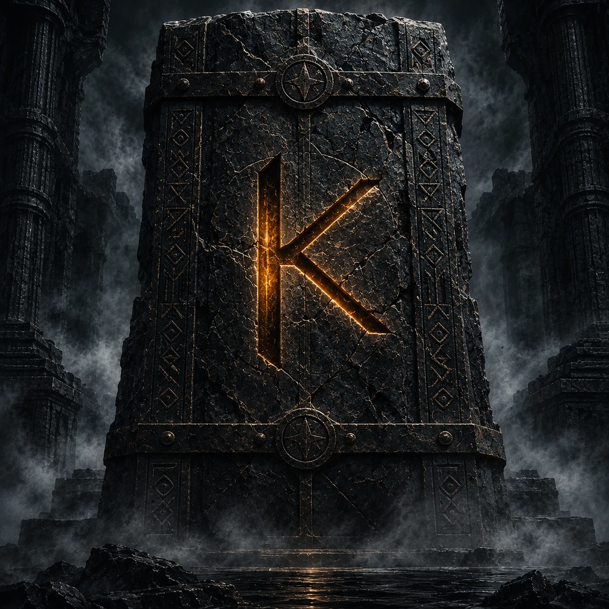

# Charte visuelle des emblèmes KTRX

Chaque outil KTRX possède un emblème, `icon.png`, placé à la racine de son dossier : `tools/<MYTHE> ( <Nom> )/icon.png`. Tous les emblèmes partagent la même énergie : une relique mythologique monumentale, filmée comme une pièce d’archive classée « secret défense ».

L’emblème est affiché sur le [site du registre KTRX](https://ktrx-site.tiagoantunes2009.workers.dev) : sur la carte de l’outil dans le catalogue et en tête de sa page. Il n’apparaît **pas** dans les README GitHub, qui restent sans image.

## Spécifications du fichier

| Critère | Valeur |
|---|---|
| Nom et emplacement | `icon.png`, à côté de `README.md` et `manifest.toml` |
| Format | PNG |
| Ratio | **1:1** (carré) |
| Taille recommandée | 1024 × 1024 px (minimum 512 × 512) |
| Poids | idéalement sous 2 Mo |
| Texte dans l’image | aucun : le nom est ajouté par le site |
| Archive `.tool` | `icon.png` n’y est pas inclus : l’archive contient uniquement `manifest.toml` et `module.wasm` |

## Emblème par défaut



Le monolithe scellé au sigle K, [`docs/images/default-icon.png`](images/default-icon.png), est l’emblème universel de KTRX. Il sert d’emblème provisoire à tout outil qui n’a pas encore le sien :

- un nouvel outil commence par copier ce fichier en `icon.png` dans son dossier ; sa carte sur le site s’affiche immédiatement ;
- remplacer `icon.png` par l’emblème propre à l’outil suffit, sans toucher au README ;
- le site utilise une pastille à l’initiale de l’outil quand aucun emblème n’est publié.

### Prompt de l’emblème par défaut

```text
Monumental sealed stone monolith of an ancient classified archive, a tall slab of weathered grey stone and tarnished metal with a single carved geometric sigil in the center, an angular letter K formed by a vertical bar and two diagonal strokes, deep carved glyphs and runic marks running along the edges, a thin amber light glowing inside the carved sigil, cracked surface, iron bands and rivets binding the slab like a vault seal, low-key dramatic lighting, volumetric fog at the base, desaturated blue-grey palette with a single amber accent glow, heavy black shadows, centered symmetrical composition, cinematic, gritty realistic texture, ancient mythological artifact, classified secret-archive mood, no other text, no letters except the carved sigil, no watermark, no logo
```

## Direction artistique

Références : une idole de pierre monolithique aux glyphes gravés (référence principale), une créature mythologique sombre aux yeux ambrés, et un dossier « STRICTLY CONFIDENTIAL / TOP SECRET » pour le cadre documentaire.

- **Matière** : pierre taillée ou métal terni, fissures, gravures, glyphes et runes.
- **Lumière** : basse luminosité, éclairage dramatique, brume volumétrique, ombres profondes.
- **Palette** : gris-bleu désaturé, noirs profonds, **un seul accent ambre** (yeux, braise, fissure incandescente).
- **Composition** : sujet unique, centré, symétrique, avec de l’espace négatif autour.
- **Ambiance** : artefact antique classé, archive secrète, cinématographique et réaliste.
- **À éviter** : couleurs vives, cartoon, vecteur plat, technologie moderne, texte, logo, filigrane.

### Bloc de style commun (à coller dans chaque prompt)

```text
Dark cinematic fantasy-archive style, monumental sculpted grey stone and tarnished metal, carved glyphs and runic marks, low-key dramatic lighting, volumetric fog, desaturated blue-grey palette with a single amber accent glow, heavy black shadows, centered symmetrical composition, gritty realistic texture, ancient mythological artifact, classified secret-archive mood, no text, no letters, no watermark, no logo
```

Paramètres : ratio 1:1, image de référence de style avec un poids modéré (`--sref` sur Midjourney), même *seed* si possible. Prompt négatif : `text, letters, watermark, signature, bright colors, cartoon, anime, flat vector, blurry, extra limbs, modern technology`.

### Modèle de prompt

```text
<SUJET MYTHOLOGIQUE : relique, statue ou créature sculptée dans la pierre ou le métal>, <détail lié à la fonction de l’outil>, <BLOC DE STYLE COMMUN>
```

## Sujets recommandés

Le sujet évoque le mythe, et un détail renvoie à la fonction de l’outil.

| Outil | Sujet |
|---|---|
| K~ANUBIS | masque de chacal en pierre, balance de la pesée du cœur |
| K~ARGUS | tête de géant couverte d’yeux sculptés, un seul éveillé en ambre |
| K~ASCLEPIUS | bâton enroulé d’un serpent, gravures médicales antiques |
| K~ATHENA | casque corinthien et chouette de pierre |
| K~CERBERUS | chien à trois têtes sculpté, yeux ambrés |
| K~HADES | heaume monumental du dieu des enfers, brume de l’oubli |
| K~HECATE | torches jumelles à un carrefour de pierre |
| K~HEPHAESTUS | enclume et marteau dans une forge froide, braise ambrée |
| K~HERMES | sandales ailées de métal, caducée |
| K~HORUS | œil d’Horus gravé dans un monolithe |
| K~IRIS | arc de pierre fendu, un éclat ambre à travers la brume |
| K~JANUS | double visage de pierre, deux portes |
| K~METIS | masque au regard intelligent, fils entrelacés |
| K~ODYSSEUS | labyrinthe gravé, proue de navire antique |
| K~POSEIDON | trident dressé dans une mer de brume |
| K~PROMETHEUS | titan de pierre tenant une braise ambrée |
| K~SPHINX | sphinx de pierre aux griffes gravées d’énigmes |
| K~THEMIS | balance et bandeau de la justice en métal terni |
| K~THOTH | tête d’ibis et calame, tablette de glyphes |

### Exemples complets

**K~HADES**

```text
Monumental carved stone helm of Hades, god of the underworld, a heavy ancient helmet with the shadowy void of the eye-slits, the face half-sunk in darkness, weathered grey stone cracked with carved glyphs and one-way inscriptions, faint pale mist rising from the eye-slits like the river Lethe, low-key lighting from below, volumetric fog, desaturated blue-grey palette with a single amber glow in the depths of the helmet, heavy black shadows, centered symmetrical composition, cinematic, gritty realistic texture, ancient mythological artifact, classified secret-archive mood, no text, no letters, no watermark, no logo
```

**K~ARGUS**

```text
Monumental carved stone head of Argus Panoptes, the hundred-eyed giant, a massive grey stone face covered in dozens of carved watchful eyes across the brow, cheeks and temples, most eyes closed in stone and a few glowing with a single amber light, deep carved glyphs and cracks in the stone, low-key dramatic lighting, volumetric fog, desaturated blue-grey palette with amber eye glow, heavy black shadows, centered symmetrical composition, cinematic, gritty realistic texture, ancient mythological artifact, classified secret-archive mood, no text, no letters, no watermark, no logo
```

## Publication de l’emblème

`scripts/publish-tools.sh` envoie `icon.png` au registre en même temps que l’archive de l’outil : l’image est réduite à 320 px pour le web, l’original reste dans le dépôt. Republier suffit à remplacer l’emblème d’un outil déjà en ligne (voir [`docs/REGISTRY.md`](REGISTRY.md)).

## Contrôle avant livraison

1. `icon.png` est présent à la racine du dossier de l’outil, au format 1:1 (à défaut, une copie de l’emblème par défaut).
2. Le style respecte la charte : pierre ou métal, lumière basse, gris-bleu désaturé, un seul accent ambre, aucun texte.
3. Le README de l’outil ne contient aucune image (le site affiche l’emblème lui-même).
